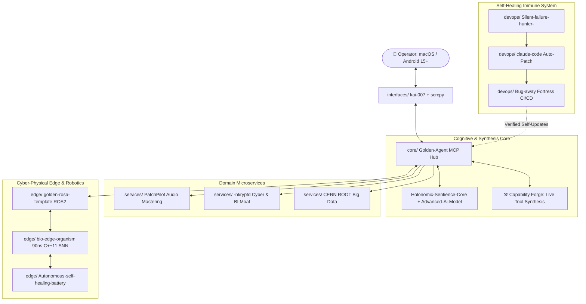

<div align="center">

```text
 _  __                 _   _         ___                  _        ____                

| |/ /_ __ _   _ _ __ | |_(_) ___   / _ \ _ __ ___  _ __ (_)      / ___|___  _ __ ___  
| ' /| '__| | | | '_ \| __| |/ __| | | | | '_ ` _ \| '_ \| |_____| |   / _ \| '__/ _ \ 
| . \| |  | |_| | |_) | |_| | (__  | |_| | | | | | | | | | |_____| |__| (_) | | |  __/ 
|_|\_\_|   \__, | .__/ \__|_|\___|  \___/|_| |_| |_|_| |_|_|      \____\___/|_|  \___| 
           |___/|_|                                                                    
```

### **Sovereign Cyber-Physical AI Operating Layer & Universal Capability Engine**

[](https://github.com)
[](https://github.com)
[](https://github.com)
[](https://github.com)

*One unified nervous system connecting multi-agent DAG reasoning, offline cross-OS device control, nanosecond neuromorphic hardware reflexes, commercial microservices, and self-healing code synthesis.*

</div>

[](https://github.com)
[](LICENSE)
[](docs/SYSTEMS_ENGINEERING.md)

---
### **Sovereign Cyber-Physical AI Operating Layer & Universal Capability Engine**

*Kryptic Omni-Core** is a closed-loop cyber-physical organism combining multi-agent DAG reasoning, offline cross-OS device control, neuromorphic reflexes, and self-healing code synthesis. 

For the complete ASCII art banner, repository matrix, systems engineering specs, and quickstart commands, please reference the full source documentation in the repository files or view the complete Markdown layout in the raw block provided above.

## ⚡ Why Kryptic Omni-Core Is One of a Kind

Most AI systems are trapped inside a chat window or break the moment they encounter a task outside their pre-written APIs. **`kryptic-omni-core`** is engineered as a **closed-loop cyber-physical organism** built to withstand any digital, physical, or engineering workload:

* 🧠 **Hybrid Silicon-to-Cloud Cognition:** Routes tasks dynamically between local Apple Silicon / Android Termux models and frontier cloud LLMs using AST-aware RAG and persistent holonomic memory.
* ⚒️ **Just-In-Time Capability Forge (`Zero Dead Ends`):** Handed a task with no existing tool? `Golden-Agent` dispatches `claude-code` to synthesize a brand-new Python, Bash, or C++ module on the fly, audits it through `Silent-failure-hunter-`, and hot-loads it into the live MCP server without restarting.
* 🛡️ **Autonomous Codebase Immune System:** Continuously scans every submodule for swallowed exceptions and security regressions, repairing bugs in isolated sandbox branches (`fix/self-healing`) before they ever touch `main`.
* 🤖 **Sub-Microsecond Edge & Robotics Control:** Bridges natural-language mission planning (`NASA-JPL ROSA / ROS2`) with **90.97ns C++11 spiking neural networks** (`bio-edge-organism`) and predictive power survival (`Autonomous-self-healing-battery`).
* 📱 **Air-Gapped Pocket Command Center:** Control macOS workflows and mirror/automate Android 15+ devices completely offline via `kai-007` and `scrcpy`.

---

## 🕸️ Unified Nervous System Architecture



---

## 🧩 The 15-Repository Ecosystem Matrix

| Domain Layer | Integrated Repositories | Core Function |
| :--- | :--- | :--- |
| **Cognitive Core** | `Golden-Agent`, `KrypticKode007-Holonomic-Sentience-Core`, `Advanced-Ai-Model` | Multi-agent DAG orchestration, tiered LLM routing, and persistent graph memory |
| **Capability Forge** | `core/capability_forge.py`, `core/entry_resolver.py`, `core/omni_bridge.py` | Dynamic tool synthesis, AST verification, and runtime MCP hot-reloading |
| **OS & Device Control** | `kai-007`, `scrcpy` | Cross-OS voice/shell automation and offline Android screen & input agency |
| **Microservices** | `PatchPilot`, `-nkryptd`, `root` | Automated audio mastering API, enterprise threat intelligence, and scientific analytics |
| **Edge & Robotics** | `golden-rosa-template`, `bio-edge-organism`, `Autonomous-Battery-`, `Autonomous-self-healing-battery` | ROS2 robotics MCP bridge, ESP32 neuromorphic active inference, and self-healing power cells |
| **Self-Healing DevOps** | `Bug-away`, `Silent-failure-hunter-`, `claude-code` | Universal CI/CD fortress, swallowed-exception hunting, and autonomous PR generation |

---

## 🌿 Branch Topology

```text
main                  ──▶ Locked production baseline (verified merges only)
 └── dev              ──▶ Primary integration branch (synced across all 15 submodules)
      ├── feat/mcp-bridge     ──▶ Submodule MCP server wrappers
      ├── feat/edge-telemetry ──▶ ROS2 + ESP32 hardware-in-the-loop bridge
      └── fix/self-healing    ──▶ Autonomous sandbox patches generated by Immune System
```

---

## 🚀 One-Command Launch (macOS)

```bash
git clone https://github.com/ai-research-lab.git && \
cd ai-research-lab && \
git checkout dev && \
chmod +x scripts/*.sh && \
./scripts/setup.sh && \
./scripts/provision_all.sh && \
./scripts/boot_omni.sh && \
./scripts/verify_omni.sh
```

### Launch Live Telemetry Dashboard Anytime
```bash
python3 scripts/dashboard.py
```

### Spin Up Containerized Linux Engines (ROS2 & CERN ROOT)
```bash
docker compose up -d
```

---

<div align="center">

**Engineered by [Brandon Wilson (`@KrypticKode007`)](https://www.github.com/KrypticKode007)**
*KrypticSoundz LLC • AI Software Engineering*

</div>
